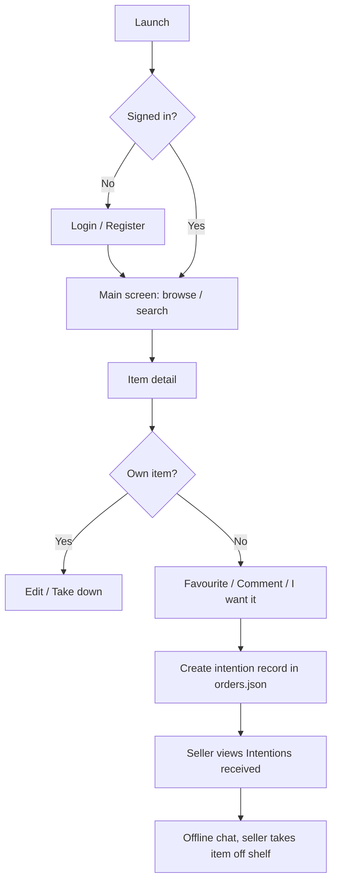

# Campus Second-hand Goods Management System — Product Requirements Document (PRD)

| Field | Content |
|---|---|
| Course | INT 6064 (Group Project) |
| Project | Campus Second-hand Goods Management System |
| Document version | v1.0 (English edition) |
| Document status | Requirements baseline |
| Author | Member E (Documentation & Reporting) |
| Reviewers | Members A / B / C / D |
| Created | 5 October 2026 |
| Tech stack | Python  + Tkinter + JSON local-file storage |
| Delivery form | Desktop stand-alone application (prototype, not a production release) |

---

## Table of Contents

1. [Purpose and Audience](#1-purpose-and-audience)
2. [Background and Problem Definition](#2-background-and-problem-definition)
3. [Product Goals and Success Criteria](#3-product-goals-and-success-criteria)
4. [Target Users and Scenarios](#4-target-users-and-scenarios)
5. [Scope](#5-scope)
6. [Functional Requirements](#6-functional-requirements)
7. [Key Business Flows](#7-key-business-flows)
8. [Information Architecture and Screen Design](#8-information-architecture-and-screen-design)
9. [Data Design](#9-data-design)
10. [Module Breakdown and Interface Contract](#10-module-breakdown-and-interface-contract)
11. [Non-functional Requirements](#11-non-functional-requirements)
12. [Implementation Plan and Team Allocation](#12-implementation-plan-and-team-allocation)
13. [Test Plan](#13-test-plan)
14. [Risks and Mitigation](#14-risks-and-mitigation)
15. [Deliverables](#15-deliverables)
16. [Open Questions and Assumptions](#16-open-questions-and-assumptions)
17. [Appendices](#17-appendices)

---

## 1. Purpose and Audience

### 1.1 Purpose

This document converts the proposal agreed by the team in Phase 1 into **executable, verifiable** requirements, and serves as the single source of truth for parallel development. It settles three things:

- **What to build**: functional boundaries, priorities and acceptance criteria.
- **How to connect**: module boundaries, data structures and function signatures, so that five people can develop in parallel without blocking each other or fighting merge conflicts.
- **When it is done**: test cases, milestones and deliverables, aligned with the marking criteria.

### 1.2 Audience

| Reader | Sections of interest |
|---|---|
| ZHANG ZHAOWEN (backend & data) | 6, 9, 10, 11 |
| GAO JINGYAN (Tkinter UI) | 6, 7, 8, 10 |
| DU YI (favourites, messages, intentions, logging) | 6, 9, 10 |
| ZHAO XIAOJUN (testing & debugging) | 6, 11, 13 |
| HUANG BAIQI (documentation & presentation) | All |

### 1.3 Terminology

| Term | Meaning |
|---|---|
| Item / listing | One second-hand item record: name, category, price, description, image path, status |
| On sale | Visible to other users; can be browsed, searched, favourited, commented on and requested |
| Off shelf | Hidden from the public list, visible only to its publisher; the record is retained, never deleted |
| Intention order | A buyer's expression of purchase interest. **No real transaction or payment is involved** |
| User | The only role in the system (no administrator role in this project) |
| Data file | A JSON file under `data/` |

> Throughout this document, "must / shall" denotes a mandatory requirement (P0); "should / may" denotes optional scope (P1/P2).

---

## 2. Background and Problem Definition

### 2.1 Background

Second-hand trading on campus has long relied on dispersed channels such as WeChat groups, Moments and notice boards, which produce three recurring problems:

- **Scattered information**: the same listing appears across several group chats and is buried within days, making it hard for buyers to retrieve.
- **No retrieval capability**: group chats can only be scrolled; there is no filtering by category (books / electronics / clothing / daily necessities) or keyword.
- **Opaque status**: whether an item is still available, whether the seller is still on campus, and whether a contact is valid are all unrecorded, so both sides repeatedly ask the same questions.

### 2.2 Problem statement

> Students and staff want a **lightweight, locally run tool — no external platform account, no online payment** — that supports the full loop of "publish → browse → search → communicate → register interest". No low-cost vehicle currently carries that loop.

### 2.3 Approach

Build a **stand-alone desktop prototype** with Python and Tkinter: local JSON files replace a database, a graphical interface replaces the command line, and "intention registration" replaces real ordering and payment. This delivers a **complete, demonstrable and testable** minimum viable product within one course cycle.

### 2.4 Non-goals (explicitly out of scope)

- No real online payment, escrow, refund or reconciliation.
- No logistics, shipping labels or delivery-address management.
- No instant messaging (no chat room, no push notifications); only **per-item comments**.
- No multi-device sync, server deployment, or institutional single sign-on.
- No image hosting or cloud storage; only a local image path is recorded.

---

## 3. Product Goals and Success Criteria

### 3.1 Product goals

| ID | Goal | Value delivered |
|---|---|---|
| G1 | Implement create, view, update and take-down (CRUD) for items | Information has a single maintainable home |
| G2 | Support category filtering plus keyword search | Solves the core "cannot find it" pain point |
| G3 | Provide registration/login, favourites and comments | Creates a selection and communication path between buyer and seller |
| G4 | Record operation logs and intention orders | Traceability for testing and reporting |
| G5 | GUI, clearly layered code, unit tests | Meets course requirements on engineering quality and demo |

### 3.2 Definition of success

At project close, all of the following must hold:

1. **100% of P0 requirements pass acceptance**, with no blocker-level defects.
2. The demo runs end-to-end in **under 5 minutes**: register → log in → publish → search → favourite → comment → submit intention → view intention → take down, with no crash and no unexpected error dialog.
3. All `unittest` cases pass, and critical `service`-layer functions achieve **≥ 70% branch coverage** against the case list (no line-coverage tooling required).
4. Data files remain **loadable and uncorrupted** after invalid input and after a forced process kill.
5. All deliverables are complete: source code, data files, test records, report, presentation slides.

### 3.3 Measurable targets (prototype level)

| Metric | Target |
|---|---|
| Cold start to an interactive login screen | ≤ 3 s |
| List scrolling / search response with 1,000 items | ≤ 1 s |
| Form input rejection rate (per Chapter 13 cases) | 100% |
| First-time user completes "publish one item" | ≤ 2 min, unaided |

---

## 4. Target Users and Scenarios

### 4.1 Personas

| Persona | Description | Primary need | Main pain point |
|---|---|---|---|
| Seller student (P1) | Final-year or postgraduate student clearing items at graduation or change of season | Publish quickly, take down at any time, see who is interested | Publishing is tedious; listings sink |
| Buyer student (P2) | Junior student on a budget | Find cheap textbooks and accessories by category | Cannot filter; cannot tell whether an item is still available |
| Resident staff (P3) | Needs office or household items | Precise keyword search | Group-chat noise |

### 4.2 User scenarios

**S1 Graduation clearance (seller)**
Alice has six course textbooks and an old monitor. She registers, then publishes each item with the right category ("Books" / "Electronics"), price and description. Three days later someone comments on the monitor; she reads the comment and agrees, the buyer submits an intention, she sees the record under "Intentions received" and finally takes the monitor off shelf.

**S2 Looking for a textbook (buyer)**
Bob needs a *Computer Networks* textbook. He logs in, types "network" in the search box and ticks the "Books" category; three on-sale results remain. He opens a detail page, checks the description and seller nickname, favourites one, comments to ask whether notes are included, and submits a purchase intention.

**S3 Anonymous browsing (visitor, optional P1)**
A signed-out user may browse the list and detail pages; on favourite, comment or intention actions the system prompts "Please log in first" and routes to the login screen.

### 4.3 Preconditions and constraints

- A single user session runs on one machine; by default only one instance of the program is open (no multi-process concurrency).
- Data lives only in the local `data/` directory; moving to another machine requires copying the whole directory.
- UI language: English for this edition (identifiers and comments also English; the Chinese edition remains available separately).

---

## 5. Scope

### 5.1 In scope

| Module | Content | Priority |
|---|---|---|
| User | Register, log in, change nickname | P0 |
| Item | Publish, list, detail, edit, take down, search, category filter | P0 |
| Favourite | Add, remove, my favourites | P0 |
| Message | Comment on a listing, view all comments | P0 |
| Intention order | Submit intention, my intentions, intentions received | P0 |
| Log | Write key operations to a log file | P0 |
| Engineering quality | Layered structure, comments, `unittest`, report, slides | P0 |

### 5.2 Out of scope

- Real payment, order fulfilment, ratings and reputation.
- Admin console, abuse reporting, sensitive-word filtering.
- Image upload, compression, thumbnail generation, cloud storage.
- Push notifications, direct messaging, email/SMS alerts.
- UI language switching (English UI only in this edition; separate Chinese edition exists).
- Password recovery, email/phone verification, third-party login.

### 5.3 Release strategy

- **v1.0 (this delivery)**: all P0 items plus anonymous browsing (P1).
- **v1.1 (stretch, not required)**: automatic expiry (items older than 30 days flagged "possibly sold"), list sorting by price / time.

---

## 6. Functional Requirements

### 6.0 Numbering and priority rules

- Format: `FR-<module>-NN`, e.g. `FR-U-01` (U user, I item, F favourite, M message, O intention, L log, UI interface).
- Priority: **P0 must** (without it the demo fails), **P1 should** (do if capacity allows), **P2 optional**.
- Every requirement carries acceptance criteria, so Member D can write test cases against it and "built" never means "done".

---

### 6.1 User Module

#### FR-U-01 Registration (P0)

**Description**: A visitor registers with a username, password and nickname; the account is written to `users.json`.

**Input fields**

| Field | Required | Rule |
|---|---|---|
| username | Yes | 3–20 characters; letters, digits and underscore only; globally unique (case-insensitive comparison) |
| password | Yes | 6–32 characters; must not be all spaces |
| nickname | No | ≤ 20 characters; defaults to the username when empty |

**Processing**: validate → generate `user_id` (`U` + 4-digit sequence, e.g. `U0001`) → hash the password with `hashlib.sha256` → append to `users.json` → write operation log (`action=register`).

**Acceptance criteria**

1. A valid registration creates exactly one new record in `users.json` with all fields present and `created_at` set to the current time.
2. A duplicate username (including a different case, e.g. `Abc` vs `abc`) is rejected with "Username already exists" and nothing is written.
3. A username containing spaces, non-ASCII characters or symbols, or shorter than 3 / longer than 20 characters, is rejected with a specific message.
4. A password shorter than 6 characters is rejected with "Password must be at least 6 characters".
5. Any missing required field shows "Please complete all required fields" and the screen does not navigate away.
6. The password **never** appears in plain text in `users.json`.

#### FR-U-02 Login (P0)

**Description**: A registered user logs in with username and password, enters the main screen and establishes a session.

**Processing**: look up by username (case-insensitive) → compare password digests → on success store `current_user` in memory → log `action=login, result=success`; on failure log `result=fail` and **keep** the entered username in the field.

**Acceptance criteria**

1. Correct credentials log in successfully and the window title shows the current nickname.
2. Unknown username and wrong password both show the single message "Incorrect username or password" (no distinction, to avoid information disclosure).
3. After 5 consecutive failures, that username is locked for 60 seconds within the current run, with a countdown message (P1; must be configurable if implemented).
4. Accessing "My favourites / My intentions / Publish" while signed out shows "Please log in first" and routes to login.

#### FR-U-03 Change nickname (P0)

**Description**: A signed-in user may change their nickname under "Settings".

**Acceptance criteria**

1. Nickname length 1–20 characters; on save, the nickname updates **immediately** on the main screen and on item cards.
2. An empty nickname is rejected with "Nickname cannot be empty".
3. A successful change is persisted to `users.json` and logged (`action=update_nickname`).

#### FR-U-04 Log out (P1)

**Acceptance criteria**: Logging out returns to the login screen and clears `current_user`; login-protected actions still prompt for login.

---

### 6.2 Item Module

#### FR-I-01 Publish an item (P0)

**Description**: A signed-in user publishes an item, which defaults to status `on_sale`.

**Input fields**

| Field | Required | Rule | Control |
|---|---|---|---|
| name | Yes | 1–40 characters; non-empty after trimming | Single-line entry |
| category | Yes | Enum: Books / Electronics / Clothing / Daily necessities | Read-only combobox |
| price | Yes | Numeric, > 0, ≤ 99999, at most 2 decimals | Single-line entry |
| description | Yes | 1–500 characters | Multi-line text |
| image_path | No | Local absolute or relative path; file must exist and end with `.png/.jpg/.jpeg/.gif` | "Choose image" button + path label |
| contact | No (P1) | ≤ 50 characters (e.g. a WeChat ID) | Single-line entry |

**Processing**: validate → generate `item_id` (`I` + 4 digits) → record `seller_id`, `status=on_sale`, `created_at`, `updated_at` → append to `items.json` → log (`action=create_item`) → return to the list and refresh with the new item on top.

**Acceptance criteria**

1. A valid publish places the item first in the public list, with name, price, category and seller nickname visible on the card.
2. Prices `abc`, `-1`, `0`, `1.234`, `1e5` are all rejected with "Please enter a valid price above 0 (up to two decimals)".
3. An empty (or whitespace-only) name or description is rejected with a field-specific message.
4. A 501-character description is either rejected or truncated — one behaviour must be chosen, applied consistently and stated in the report.
5. Publishing without an image succeeds and the detail page shows a placeholder without crashing.
6. A path pointing to a missing file still publishes successfully, but the detail page shows "Image unavailable" and raises no exception.
7. After publishing, the item appears in the publisher's "My listings".

#### FR-I-02 Browse the item list (P0)

**Description**: The main screen lists all `on_sale` items.

**Display rules**

- Sort: `created_at` descending by default (newest first); P1 adds "price ascending / descending".
- Card fields: thumbnail (or placeholder), name, price, category tag, seller nickname, publish time (`YYYY-MM-DD HH:MM`).
- Pagination: 20 per page with "Previous / Next" and a page indicator (P1); without pagination, scrolling must remain usable up to 1,000 items.
- Empty state: "No items on sale yet — be the first to publish one."

**Acceptance criteria**

1. Items that are off shelf never appear in the public list, but remain visible in the publisher's "My listings" marked "Off shelf".
2. Only `on_sale` records are listed, and paging never mixes data.
3. Re-entering the main screen shows a list consistent with `items.json`.

#### FR-I-03 Item detail (P0)

**Description**: Clicking a card opens a detail page with full information and that item's comments.

**Content**: name, price, category, description, image, seller nickname, publish time, status; comment list; action buttons by role.

**Button visibility**

| Viewer | Visible actions |
|---|---|
| Visitor | Prompt to log in for favourite / comment / "I want it" (routes to login) |
| Other signed-in user | Favourite / unfavourite, comment, submit intention |
| Publisher | Edit, take down; the "submit intention" button is hidden on their own item |

**Acceptance criteria**

1. Detail fields match the list card and the full description is displayed (scrollable if long).
2. An off-shelf item is unreachable from public entry points; if reached via "My listings", a banner reads "This item is off shelf".
3. Publishers do not see "Submit intention" on their own items.
4. A missing or broken image path does not crash the page; a placeholder and message are shown.

#### FR-I-04 Edit an item (P0)

**Description**: The publisher may edit name, category, price, description, image and contact of their own item.

**Acceptance criteria**

1. Only the publisher may edit; anyone else receives "You are not allowed to perform this action".
2. Validation rules are identical to FR-I-01.
3. On save, `updated_at` changes while `created_at` stays; list and detail refresh accordingly.
4. Editing does not affect existing favourites, comments or intentions on that item.

#### FR-I-05 Take an item off shelf (P0)

**Description**: The publisher may set an item's status to `off_shelf`.

**Acceptance criteria**

1. A confirmation dialog appears first: "Once off shelf, other users cannot see this item. Continue?"
2. On confirmation the status is persisted and the item disappears from the public list immediately.
3. Off-shelf items appear greyed out in "My listings" marked "Off shelf"; P1 allows re-listing.
4. **Physical deletion is not offered** (to prevent accidental loss and loss of history); the rationale must be stated in the report.

#### FR-I-06 Keyword search and category filter (P0)

**Description**: The main screen offers a search box and a category selector, combinable.

**Rules**

- Keyword: trimmed, case-insensitive, substring match against **name or description** (plain `in` check; no tokenisation in this project).
- Category: defaults to "All", otherwise one of the four.
- The two combine with **AND**; a reset button clears the keyword and restores "All".
- No results: "No matching items — try a different keyword."
- Result count: "N item(s)".

**Acceptance criteria**

1. Keyword `network` + category `Books` returns only records satisfying both.
2. Mixed case (`IPAD` / `ipad`) yields identical results.
3. A whitespace-only keyword behaves like no keyword (full list, or filtered by the current category).
4. Reset returns to the default full list.
5. Search never mutates data and writes no log (P2: may log search terms for analytics).

---

### 6.3 Favourite Module

#### FR-F-01 Add / remove favourite (P0)

**Description**: A signed-in user favourites an item from its detail page; duplicates are prevented.

**Acceptance criteria**

1. On success the button becomes "Favourited (click to remove)" and a `(user_id, item_id, created_at)` record is appended to `favorites.json`.
2. Duplicate favouriting is blocked with "Already favourited"; no duplicate record appears.
3. Removing deletes the record, restores the button, and leaves no matching entry in `favorites.json`.
4. Off-shelf items cannot be newly favourited; message "This item is off shelf".

#### FR-F-02 My favourites (P0)

**Acceptance criteria**

1. Items are listed by favourite time descending, showing name, price, status and seller nickname.
2. Clicking a card opens the detail page; favourites can be removed here, and the card disappears immediately.
3. If an item has been taken down, the card remains but is marked "Off shelf"; clicking shows a read-only view or a notice — one behaviour must be chosen and documented.
4. Empty state: "No favourites yet — go and browse."

---

### 6.4 Message Module

#### FR-M-01 Post a comment (P0)

**Description**: A signed-in user comments on an item's detail page.

**Rules**: content 1–200 characters, non-empty after trimming; no whitespace-only content; rate limit of 3 comments per user per item per 60 seconds (P1 anti-spam).

**Acceptance criteria**

1. A successful comment appears immediately in the comment list with the commenter's nickname and timestamp.
2. Empty or over-200-character comments are rejected with a message.
3. A signed-out user clicking "Comment" is routed to login; after login they return to the same detail page (P1).
4. Off-shelf items show no comment input, but historical comments remain visible read-only.
5. Comments persist to `messages.json` and are logged (`action=add_message`).

#### FR-M-02 View comments (P0)

**Acceptance criteria**

1. The detail page lists all comments for that item in **ascending** time order (oldest first), scrollable.
2. Empty state: "No comments yet — be the first to ask."
3. Comments belong strictly to their item and never appear on another item's page.

---

### 6.5 Intention Order Module

#### FR-O-01 Submit a purchase intention (P0)

**Description**: A buyer clicks "I want it" on a detail page, registering an intention record (**no payment involved**).

**Processing**: generate `order_id` (`O` + 4 digits); store `item_id`, a snapshot `item_name`, `buyer_id`, `seller_id`, `created_at`, `status=intent` in `orders.json`; write log.

**Validation**

- The user must be signed in.
- A user may not submit an intention for their own item.
- Only one active intention per buyer per item ("You have already submitted an intention for this item").
- The item must be `on_sale`.

**Acceptance criteria**

1. On success a message reads "Intention submitted — see it under My intentions", and the button becomes "Submitted".
2. The seller sees the record under "Intentions received" with buyer nickname and timestamp.
3. All four validation rules produce their own message and no dirty data.

#### FR-O-02 My intentions (P0)

**Acceptance criteria**

1. Intentions the user submitted are listed newest first, with item name, seller nickname, submission time and status.
2. If the item went off shelf, the record remains and is marked "Item off shelf".
3. Empty state: "You have not submitted any intentions yet."

#### FR-O-03 Intentions received (P0)

**Acceptance criteria**

1. The publisher can view intentions per item, including buyer nickname and submission time.
2. Only intentions on the user's own items are visible.
3. Empty state: "No one has expressed interest yet."

> Note: accept/reject transitions for intentions are **out of scope** (to avoid scope creep). If required later, they become a v1.1 requirement and must be documented in the report.

---

### 6.6 Log Module

#### FR-L-01 Operation logging (P0)

**Covered actions**: `register`, `login` (including failures), `logout`, `create_item`, `update_item`, `take_down_item`, `add_favorite`, `remove_favorite`, `add_message`, `create_intent`.

**Log format** (`logs.json`)

```json
{
  "log_id": "L0001",
  "timestamp": "2026-11-19 10:06:31",
  "user_id": "U0001",
  "username": "alice",
  "action": "create_item",
  "target_id": "I0003",
  "result": "success",
  "detail": "Published item 'Computer Networks'"
}
```

**Acceptance criteria**

1. Each covered action produces exactly one log entry; failed actions record `result=fail` with a `detail` reason.
2. A logging failure **must not** crash the main flow (catch the exception and warn on the console).
3. Logs are append-only; history is never rewritten.
4. P1: a "View log" window shows the current user's entries (newest first, max 200).

---

### 6.7 Interface Requirements (UI)

| ID | Screen / component | Priority | Key points |
|---|---|---|---|
| FR-UI-01 | Login | P0 | Username, password, sign-in button, link to registration; Enter submits |
| FR-UI-02 | Registration | P0 | Three fields + submit; links back to login |
| FR-UI-03 | Main screen (list) | P0 | Search + category + reset on top; scrolling card list; status bar shows current user and item count |
| FR-UI-04 | Publish / edit form | P0 | Form + inline validation + save/cancel; edit is pre-filled |
| FR-UI-05 | Item detail | P0 | Information block, image block, comment block, action bar |
| FR-UI-06 | My favourites | P0 | List, remove, empty state |
| FR-UI-07 | My intentions / received | P0 | Tabs for the two views |
| FR-UI-08 | Settings | P1 | Change nickname, log out |
| FR-UI-09 | Unified dialogs | P0 | Success / error / confirmation via `messagebox`; English copy only, never raw exception text |

**General UI requirements**

- One main window with `Frame`-switched pages (avoid stacked windows); dialogs only for confirmation and notices.
- Default window 1000×680, minimum 900×600; controls must not overlap when resized.
- One font family with system fallback (Segoe UI / Helvetica / PingFang, whichever exists); headings 14–16 pt bold, body 11 pt.
- At most four primary colours (background, primary, accent, error); errors always red.
- Any action on up to 1,000 records must not freeze the UI for more than 0.5 s.

---

## 7. Key Business Flows

### 7.1 Main flow: publish → expressed interest



### 7.2 Item state machine

```
          publish                     take down
  (none) ──────────► on_sale ──────────────────► off_shelf
                       │  ▲                        │
            edit update│  │ re-list (P1)           │
                       └──┘                        │
                       │                           │
                       └──── status change only, never physical delete ────┘
```

**State constraints**

| Status | In public list | Can be favourited | Can be commented | Can receive intentions | Editable / take-down |
|---|---|---|---|---|---|
| `on_sale` | Yes | Yes | Yes | Yes | Publisher only |
| `off_shelf` | No | No (existing favourites kept) | Read-only | No | Publisher only (edit disabled after take-down, P1 re-list) |

### 7.3 Session and permission matrix

| Capability | Visitor | Signed-in user | Publisher |
|---|---|---|---|
| Browse list / detail | Yes | Yes | Yes |
| Search / filter | Yes | Yes | Yes |
| Register / log in | Yes | — | — |
| Publish | No (routes to login) | Yes | Yes |
| Favourite / comment / submit intention | No (routes to login) | Yes | Not on own items |
| Edit / take down | No | No (unless owner) | Yes |
| My favourites / my intentions | No | Yes | Yes |
| Intentions received | No | No | Yes |

---

## 8. Information Architecture and Screen Design

### 8.1 Screen structure

```
App (single Tk root)
├── LoginFrame            Login
├── RegisterFrame         Registration
└── MainFrame             Main container (after login)
    ├── TopBar            Search / category / reset / current user / publish
    ├── ItemListView      Scrolling item card list
    │   └── ItemCard      Thumbnail + name + price + category + seller + time
    ├── ItemDetailView    Detail (dialog or full-page switch)
    │   ├── InfoPanel     Name / price / category / description / seller
    │   ├── ImagePanel    Image or placeholder
    │   ├── MessagePanel  Comment list + input + send
    │   └── ActionBar     Favourite / I want it / Edit / Take down
    ├── ItemFormView      Publish / edit (same form, `mode` distinguishes)
    ├── FavoriteView      My favourites
    ├── OrderView         Tabs: My intentions / Intentions received
    └── SettingView       Settings (nickname / log out)
```

### 8.2 Navigation rules

| From | Event | To |
|---|---|---|
| Login | Successful sign-in | Main screen (list) |
| Login | "Register" | Registration |
| Registration | Successful registration | Login (username pre-filled, P1) |
| Main screen | "Publish" | Publish form |
| Main screen | Card click | Item detail |
| Detail | "Edit" | Edit form (pre-filled) |
| Detail | "Take down" | Confirmation → back to list |
| Any protected screen | Not signed in | Login + prompt |

### 8.3 Key element specifications (summary)

| Element | Specification |
|---|---|
| Item card | 96 px tall; 80×80 thumbnail on the left (proportional, never stretched); three text lines: name (bold), price (accent colour, 2 decimals), category + seller + time (grey, small) |
| Search box | 260 px wide, placeholder "Search name or description" |
| Category selector | Options: All / Books / Electronics / Clothing / Daily necessities |
| Buttons | Primary (filled), secondary (outlined), destructive (take down: red outline + confirmation) |
| Form errors | Inline red text beneath the field; dialogs reserved for overall failures |
| Empty state | Centred grey copy plus an optional call-to-action button |

---

## 9. Data Design

### 9.1 Storage scheme

- Directory: `data/` under the project root; UTF-8 encoding; `ensure_ascii=False`; 2-space indentation for human inspection.
- **One file per entity** (reduces write conflicts between parallel developers):

| File | Content | Initial value |
|---|---|---|
| `data/users.json` | Users | `[]` |
| `data/items.json` | Items | `[]` |
| `data/favorites.json` | Favourite relations | `[]` |
| `data/messages.json` | Comments | `[]` |
| `data/orders.json` | Intention orders | `[]` |
| `data/logs.json` | Operation logs | `[]` |

- A missing file is created as an empty array automatically. A corrupt file (invalid JSON) is **backed up as `.bak` and recreated empty**, with the message "Data file was corrupted; a backup was created and the file was reset" — never a crash.
- Writes are atomic: write a temp file, then `os.replace()`. A module-level `threading.Lock` guards access (a safeguard even though Tkinter is single-threaded).

### 9.2 Data structures

**users.json**

```json
[
  {
    "user_id": "U0001",
    "username": "alice",
    "password_hash": "sha256 hex string",
    "nickname": "Alice",
    "created_at": "2026-11-19 10:06:31"
  }
]
```

**items.json**

```json
[
  {
    "item_id": "I0001",
    "name": "Computer Networks (7th ed.)",
    "category": "Books",
    "price": 25.0,
    "description": "Very good condition, no notes, small discount possible.",
    "image_path": "assets/items/I0001.jpg",
    "contact": "WeChat: xxx",
    "seller_id": "U0001",
    "status": "on_sale",
    "created_at": "2026-11-19 10:06:31",
    "updated_at": "2026-11-19 10:06:31"
  }
]
```

**favorites.json**

```json
[{ "user_id": "U0002", "item_id": "I0001", "created_at": "2026-11-19 10:10:00" }]
```

**messages.json**

```json
[
  {
    "message_id": "M0001",
    "item_id": "I0001",
    "user_id": "U0002",
    "content": "Does it still have the notes?",
    "created_at": "2026-11-19 10:12:00"
  }
]
```

**orders.json**

```json
[
  {
    "order_id": "O0001",
    "item_id": "I0001",
    "item_name": "Computer Networks (7th ed.)",
    "buyer_id": "U0002",
    "seller_id": "U0001",
    "status": "intent",
    "created_at": "2026-11-19 10:15:00"
  }
]
```

**logs.json**: see FR-L-01.

### 9.3 Field constraints

| Entity | Field | Type | Constraint |
|---|---|---|---|
| User | username | str | 3–20 chars, unique (case-insensitive), `^[A-Za-z0-9_]+$` |
| User | nickname | str | 1–20 chars |
| Item | name | str | 1–40 chars, not whitespace-only |
| Item | category | str | One of the four enum values |
| Item | price | float | 0 < price ≤ 99999, ≤ 2 decimals |
| Item | description | str | 1–500 chars |
| Item | status | str | `on_sale` / `off_shelf` |
| Favourite | (user_id, item_id) | composite | Unique |
| Message | content | str | 1–200 chars |
| Order | (buyer_id, item_id) | composite | Unique, and `buyer_id != seller_id` |
| Time fields | — | str | `YYYY-MM-DD HH:MM:SS`, always via `datetime.now().strftime` |

### 9.4 ID generation

`next_id(prefix, records, id_key)` returns the maximum existing number for that prefix plus one, zero-padded to four digits, starting at `0001` for an empty file. **Never** use `len(records) + 1`, which produces duplicates after take-down or deletion.

---

## 10. Module Breakdown and Interface Contract

### 10.1 Directory structure (layered architecture)

```
campus_secondhand/
├── main.py                  # Entry: initialise data dir, start Tk main loop
├── config.py                # Constants: categories, field limits, file names, time format
├── storage.py               # Sole data-access layer (load/save/next_id/backup)
├── services/
│   ├── user_service.py      # Register, login, change nickname
│   ├── item_service.py      # Publish, list, search, detail, edit, take down
│   ├── favorite_service.py  # Add/remove/list favourites
│   ├── message_service.py   # Add/list comments
│   ├── order_service.py     # Submit intention, my/received intentions
│   └── log_service.py       # Write/read logs
├── ui/
│   ├── app.py               # Root window and page routing
│   ├── login_frame.py
│   ├── register_frame.py
│   ├── main_frame.py        # List + search bar
│   ├── item_form_frame.py
│   ├── item_detail_frame.py
│   ├── favorite_frame.py
│   ├── order_frame.py
│   └── widgets.py           # Cards, placeholder image, shared dialogs
├── utils/
│   ├── validators.py        # Username/password/price/length validation
│   └── helpers.py           # Time formatting, fault-tolerant image loading, truncation
├── data/                    # JSON data (see Chapter 9)
├── assets/                  # Placeholder and sample images
├── tests/
│   ├── test_user_service.py
│   ├── test_item_service.py
│   ├── test_favorite_service.py
│   ├── test_message_service.py
│   ├── test_order_service.py
│   └── test_storage.py
└── README.md                # How to run, demo accounts, structure
```

**Layering rules (mandatory)**

1. `ui/` calls `services/` only and **never** touches JSON directly.
2. `services/` calls `storage.py` only and **must not** import Tkinter.
3. `storage.py` is business-agnostic: file I/O and ID generation only.
4. Validation lives in `utils/validators.py`; UI and services share one rule set so the two can never diverge.

### 10.2 Interface contract (function signatures)

> The table below is a **frozen contract**. Member B may build the UI against these signatures using mock data; Members A and C implement to them, minimising integration rework. Returns are `(ok: bool, data: Any, msg: str)` or `(ok, msg)`; exceptions must not be used for ordinary business branching.

**storage.py**

| Function | Description |
|---|---|
| `load(name: str) -> list[dict]` | Read `data/{name}.json`; missing/corrupt handled per 9.1 |
| `save(name: str, records: list[dict]) -> None` | Atomic write |
| `next_id(prefix: str, records: list[dict], id_key: str) -> str` | Produce IDs like `U0001` |
| `backup(name: str) -> str` | Back up a corrupt file and return the backup path |

**user_service.py**

| Function | Description |
|---|---|
| `register(username, password, nickname="") -> (bool, dict|None, str)` | Returns the new user (without the hash) or an error message |
| `login(username, password) -> (bool, dict|None, str)` | Returns user info on success |
| `update_nickname(user_id, nickname) -> (bool, str)` | |

**item_service.py**

| Function | Description |
|---|---|
| `create_item(seller_id, name, category, price, description, image_path="", contact="") -> (bool, dict|str)` | |
| `list_items(keyword="", category="All", status="on_sale", page=1, page_size=20) -> list[dict]` | Combined filter + pagination |
| `get_item(item_id) -> dict|None` | |
| `update_item(item_id, user_id, **fields) -> (bool, str)` | Ownership checked |
| `take_down(item_id, user_id) -> (bool, str)` | |
| `list_my_items(user_id) -> list[dict]` | Includes off-shelf items |

**favorite_service.py**: `add(user_id, item_id)`, `remove(user_id, item_id)`, `is_favorited(user_id, item_id) -> bool`, `list_by_user(user_id) -> list[dict]`

**message_service.py**: `add(user_id, item_id, content)`, `list_by_item(item_id) -> list[dict]`

**order_service.py**: `create_intent(buyer_id, item_id) -> (bool, str)`, `list_my(buyer_id)`, `list_received(seller_id)`

**log_service.py**: `log(user_id, username, action, target_id="", result="success", detail="")`, `list_by_user(user_id, limit=200)`

### 10.3 Ownership boundaries (no duplicate implementations)

| Capability | Sole implementation | Note |
|---|---|---|
| Password hashing | `user_service` | Always `hashlib.sha256` |
| All validation | `utils/validators.py` | UI only renders the message |
| Time strings | `utils/helpers.now_str()` | The only time source in the project |
| Image loading and placeholder | `utils/helpers.load_thumbnail()` | Returns a placeholder on failure, never raises |
| Dialogs | `ui/widgets.show_info/show_error/confirm` | Centralised in the UI layer |

---

## 11. Non-functional Requirements

### 11.1 Environment and dependencies

- Runtime: Windows 10/11 or macOS 12+, Python **3.8 or later**.
- Dependencies: **standard library only** (`tkinter`, `json`, `os`, `re`, `datetime`, `hashlib`, `unittest`). No third-party packages, so the assessor's machine can run it directly.
- Entry point: `python main.py`; `README.md` explains that `data/` is created on first run.

### 11.2 Performance

| Scenario | Requirement |
|---|---|
| Startup | ≤ 3 s (cold start to login screen) |
| List load | 1,000 items ≤ 1 s; 5,000 items ≤ 3 s (no optimisation promised beyond that) |
| Search / filter | 1,000 items ≤ 1 s |
| Single file write | ≤ 100 ms at 1,000-record scale |
| UI response | Widgets update within 200 ms of any action; no freezing |

### 11.3 Reliability

- Every file read/write, image load and time parse is wrapped in `try/except`, and errors are converted into readable English messages.
- Closing the window exits cleanly; with unsaved form data, a confirmation is shown (P1).
- After a forced process kill, data files must still parse (guaranteed by the atomic write in 9.1).

### 11.4 Security and privacy

- Passwords are stored only as SHA-256 digests, never in plain text, never shown in the UI or logs.
- Logs never record passwords or full contact details.
- Image paths are used only to read local files; **no shell command is ever executed**, and `os.system` is forbidden.
- User input is truncated before display (so long text cannot break layout). No HTML escaping is needed because Tkinter has no injection surface — this judgement must be stated in the report.

### 11.5 Usability and maintainability

- English UI and messages throughout; error copy follows "**cause + next step**", e.g. "Invalid price — enter a number above 0 with at most two decimals".
- PEP 8 compliance; public functions carry docstrings (parameters, return values, exceptions); non-obvious branches are commented inline.
- Functions ≤ 50 lines and files ≤ 500 lines where practical (UI files may be split further).
- Naming: `PascalCase` classes, `snake_case` functions/variables, `UPPER_CASE` constants, `_leading_underscore` for private members.

### 11.6 Compatibility

- If a preferred font is unavailable, fall back to the system default rather than rendering boxes.
- On high-DPI displays (125%/150% scaling) controls must not overlap and text must not be clipped.

---

## 12. Implementation Plan and Team Allocation

### 12.1 Milestones

| Phase | Duration | Key output | Gate condition |
|---|---|---|---|
| P1 Requirements and design freeze | Week 1 | This PRD, screen sketches, interface contract, naming conventions | Team review passed; contract frozen |
| P2 Parallel development | Weeks 2–3 | Runnable skeleton of backend + UI + auxiliary modules | Each module passes its own self-test |
| P3 Integration and system testing | Week 4 | Integrated build, test records, defect list | All P0 cases pass; no blockers |
| P4 Documentation, slides and submission | Week 5 | Report, user manual, slides, source package | Deliverables complete and rehearsed |

### 12.2 Roles and delivery boundaries

| Member | Role | Scope | Key delivery | Depends on |
|---|---|---|---|---|
| A | Backend & data | `storage.py`, `services/user_service.py`, `services/item_service.py`, `utils/validators.py` | Data layer, user/item services, validation | Contract (10.2) |
| B | GUI development | All of `ui/`, `ui/widgets.py` | Login/registration/list/detail/form/favourite/intention screens | Service signatures from A (mock data allowed) |
| C | Auxiliary features | `favorite_service`, `message_service`, `order_service`, `log_service` and their UI wiring | Favourites, comments, intentions, logging | A's storage |
| D | Testing & debugging | `tests/`, exception hardening, defect tracking | unittest suite and test records, bug list | Runnable modules |
| E | Documentation & presentation | This PRD, report, user manual, slides, bilingual proofreading | Report, slides, demo script | Team progress |

**Collaboration rules**

- One branch per person (`feat/a-storage`, etc.); sync every two days; self-test before merging.
- Interface changes must be announced in the group chat and recorded in the PRD change log; no unilateral signature changes.
- Shared files (`config.py`, `utils/*`) are owned by A; others request changes rather than editing directly.

### 12.3 Review checkpoints

| Checkpoint | Timing | Participants | Content |
|---|---|---|---|
| Requirements review | End of week 1 | All | Confirm P0 scope and acceptance criteria |
| Contract review | End of week 1 | A/B/C | Freeze signatures and data structures |
| Mid-point check | End of week 3 | All | Runnable demo per module; surface blockers |
| Acceptance review | Week 5 | All | Walk through Chapter 13 cases one by one |

---

## 13. Test Plan

### 13.1 Strategy

- **Unit tests (`unittest`)**: cover `storage` and every `service` across normal, boundary and error paths; Tkinter widget rendering is not unit-tested.
- **Manual functional testing**: execute the case table through the GUI and record actual results.
- **Robustness testing**: empty input, over-long input, invalid price, corrupted JSON, missing image, unauthorised access.
- **Demo regression**: after every merge, run the 5-minute demo flow from 3.2.

### 13.2 Core case list (sample; Member D must extend to 40+)

| Case | Module | Scenario | Input | Expected result |
|---|---|---|---|---|
| TC-U-01 | User | Valid registration | `alice / 123456 / Alice` | Success; one record added; password hashed |
| TC-U-02 | User | Duplicate username | `Alice` when `alice` exists | "Already exists"; file unchanged |
| TC-U-03 | User | Password too short | `12345` | "At least 6 characters" |
| TC-U-04 | User | Wrong password | Valid username + wrong password | "Incorrect username or password"; log `fail` |
| TC-I-01 | Item | Valid publish | All fields valid | Item appears first; `item_id=I0001` |
| TC-I-02 | Item | Invalid price | `abc` / `-1` / `0` / `1.234` | All rejected with price message |
| TC-I-03 | Item | Empty name | Whitespace only | Rejected; "Name cannot be empty" |
| TC-I-04 | Item | Edit another's item | Non-owner user_id | "Not allowed"; data unchanged |
| TC-I-05 | Item | Visibility after take-down | Take `I0001` down | Gone from public list; "Off shelf" in My listings |
| TC-I-06 | Item | Case-insensitive search | `IPAD` vs `ipad` | Identical result sets |
| TC-I-07 | Item | Search + category | `network` + `Books` | Only records satisfying both |
| TC-I-08 | Item | No results | `zzzz` | Empty-state copy; no error |
| TC-F-01 | Favourite | Duplicate favourite | Same user/item twice | Second attempt blocked; no duplicate |
| TC-F-02 | Favourite | Remove favourite | Existing favourite | Record removed; button restored |
| TC-M-01 | Message | Empty comment | `"   "` | Rejected |
| TC-M-02 | Message | Over-long comment | 201 characters | Rejected or truncated (consistent with implementation) |
| TC-O-01 | Intention | Own item | Publisher themselves | Rejected with message |
| TC-O-02 | Intention | Duplicate intention | Same buyer twice | Second attempt: "already submitted" |
| TC-O-03 | Intention | Off-shelf item | Off-shelf item | Rejected |
| TC-S-01 | Storage | Corrupted JSON | Deliberately break `items.json` | Backup + reset + message; no crash |
| TC-S-02 | Storage | ID continuity | Add after removing a middle record | No duplicate IDs |
| TC-S-03 | Storage | Missing image | Non-existent path | Placeholder; no exception |
| TC-L-01 | Log | Failed login | Wrong password | Exactly one `result=fail` entry |
| TC-L-02 | Log | Log write failure | Read-only directory | Main flow continues; console warning |

### 13.3 Defect severity and handling

| Severity | Definition | Requirement |
|---|---|---|
| Blocker | Crash, data corruption, main flow broken | Must be fixed before submission |
| Major | Functionality fails acceptance criteria | Must be fixed or formally waived in writing |
| Minor | Copy, layout or usability issue | May be deferred and listed as a known issue |
| Trivial | Typos, alignment | Fix if capacity allows |

### 13.4 Test record format

`tests/test_record.md`: case ID / scenario / steps / expected / actual / result (pass · fail) / tester / date / defect ID.

---

## 14. Risks and Mitigation

| ID | Risk | Likelihood | Impact | Mitigation | Owner |
|---|---|---|---|---|---|
| R1 | Merge conflicts across five developers | High | Medium | Freeze the interface contract; assign ownership by file/module; sync every two days; one owner for shared files | A / all |
| R2 | Messy Tkinter layouts, overlapping widgets | High | Medium | Finish page sketches and a grid convention in week 1 (consistent `grid` + `weight`); centralise in `widgets.py` | B |
| R3 | Corrupted data from faulty JSON reads/writes | Medium | High | Atomic writes (temp file + `os.replace`); module lock; automatic backup and reset on corruption; `try/except` end to end | A |
| R4 | Uneven progress; UI waiting on backend | Medium | Medium | Signatures frozen first, UI built on mocks; mid-point check surfaces blockers early | B / E |
| R5 | Scope creep (payment, chat, admin console) | High | Medium | Enforce Chapter 5 scope; new ideas go to the v1.1 backlog and are not built now | E |
| R6 | Chinese/copy encoding issues, missing fonts | Medium | Low | Always `encoding="utf-8"`; font fallback chain; validate with sample data early | A / B |
| R7 | Demo environment differences (Python version, no Tkinter) | Medium | High | Standard library only; rehearse on the assessment machine; prepare a screen recording as a fallback | D / E |
| R8 | Thin unit-test coverage; defects surface during integration | Medium | Medium | Write service-layer cases alongside implementation; run the full suite on every merge | D |

---

## 15. Deliverables

| ID | Deliverable | Form | Owner | Acceptance |
|---|---|---|---|---|
| D1 | Complete annotated source code | `campus_secondhand/` directory or zip | A/B/C | `python main.py` runs directly |
| D2 | JSON data files and sample data | `data/*.json` | A | At least 2 users, 5 items, plus comments and intentions; structure per Chapter 9 |
| D3 | Unit tests and test records | `tests/` + `test_record.md` | D | All cases pass; records complete |
| D4 | Project report (English, with Chinese summary optional) | `.docx` / `.pdf` | E | Covers background, design, implementation, testing, conclusions |
| D5 | User manual | Report chapter or standalone document | E | Installation/startup, feature guide, FAQ |
| D6 | Presentation slides | `.pptx` | E | 8–12 slides: architecture, screenshots, demo flow |
| D7 | This PRD | `prd.md` | E | Consistent with implementation; change log complete |

---

## 16. Open Questions and Assumptions

### 16.1 To confirm within the team (affects implementation; decide in week 1)

| ID | Question | Suggested default | Impact |
|---|---|---|---|
| Q1 | Is anonymous browsing required? | Adopt (P1): visitors can browse list and detail | Session-check branching |
| Q2 | May items be physically deleted? | No — take down only | Data safety and assessment impression |
| Q3 | Should images be copied into `assets/items/`? | Yes, renamed `{item_id}.{ext}` | Whether images survive a machine change |
| Q4 | Reject or truncate an over-long description? | Reject, with a remaining-characters hint | Consistency with acceptance criteria |
| Q5 | Is pagination required? | Yes (P1), 20 per page | List performance and complexity |
| Q6 | Should search terms be logged? | No (P2) | Log size and privacy |
| Q7 | Should intentions support accept/reject? | No (v1.1) | Scope control |
| Q8 | Report language: English only, or bilingual? | English with a Chinese abstract | Documentation effort |

### 16.2 Assumptions made in this document

1. Data volume stays below 5,000 records, so in-memory filtering is sufficient and no index is needed.
2. One process and one instance run at a time; no cross-process file lock is required.
3. There is no real identity verification; the username is the identity.
4. The UI is desktop-only; no mobile adaptation.
5. The assessment environment can run Tkinter (not headless).

---

## 17. Appendices

### 17.1 Category enum

`Books` / `Electronics` / `Clothing` / `Daily necessities`. To extend, add values to `CATEGORIES` in `config.py`; the UI selector reads from it and must never hard-code the list.

### 17.2 Standard message catalogue (excerpt)

| Scenario | Message |
|---|---|
| Duplicate username | Username already exists — please choose another |
| Invalid username format | Username must be 3–20 characters: letters, digits and underscores only |
| Password too short | Password must be at least 6 characters |
| Login failure | Incorrect username or password |
| Invalid price | Enter a valid price above 0 with at most two decimals |
| Item not found | This item does not exist or has been removed |
| Unauthorised action | You are not allowed to perform this action |
| Duplicate favourite | This item is already in your favourites |
| Duplicate intention | You have already submitted an intention for this item |
| No results | No matching items — try a different keyword |
| Data corrupted | The data file was corrupted; a backup was created and the file was reset |

### 17.3 Coding and submission conventions

- UTF-8 without BOM; LF line endings (normalise before submitting from Windows).
- Commit messages: `[module] short description`, e.g. `[item] add two-decimal price validation`.
- Never commit `__pycache__/`, `.DS_Store`, or real personal contact details.

### 17.4 Change log

| Version | Date | Change | Author |
|---|---|---|---|
| v1.0 | 19 November 2026 | First English edition: full translation and adaptation of the Chinese PRD, including acceptance criteria, data structures, interface contract, test plan and risks | Member E |

### 17.5 Alignment with the original proposal

| Proposal item | Location in this document | Note |
|---|---|---|
| Six functional modules | 6 (FR-U/I/F/M/O/L) | Expanded into verifiable requirements |
| Python + Tkinter + JSON + unittest | 11.1 | "Standard library only" made explicit |
| Five-member allocation | 12.2 | Adds delivery boundaries and collaboration rules |
| Four-phase schedule | 12.1 | Adds gate conditions per phase |
| Three identified risks | 14 | Expanded to eight with owners and impact ratings |
| Five expected deliverables | 15 | Expanded to seven with acceptance criteria |

---

*End of document. This PRD is the v1.0 baseline. Any change to interfaces, scope or acceptance criteria must be recorded in Section 17.4 and communicated to the whole team.*