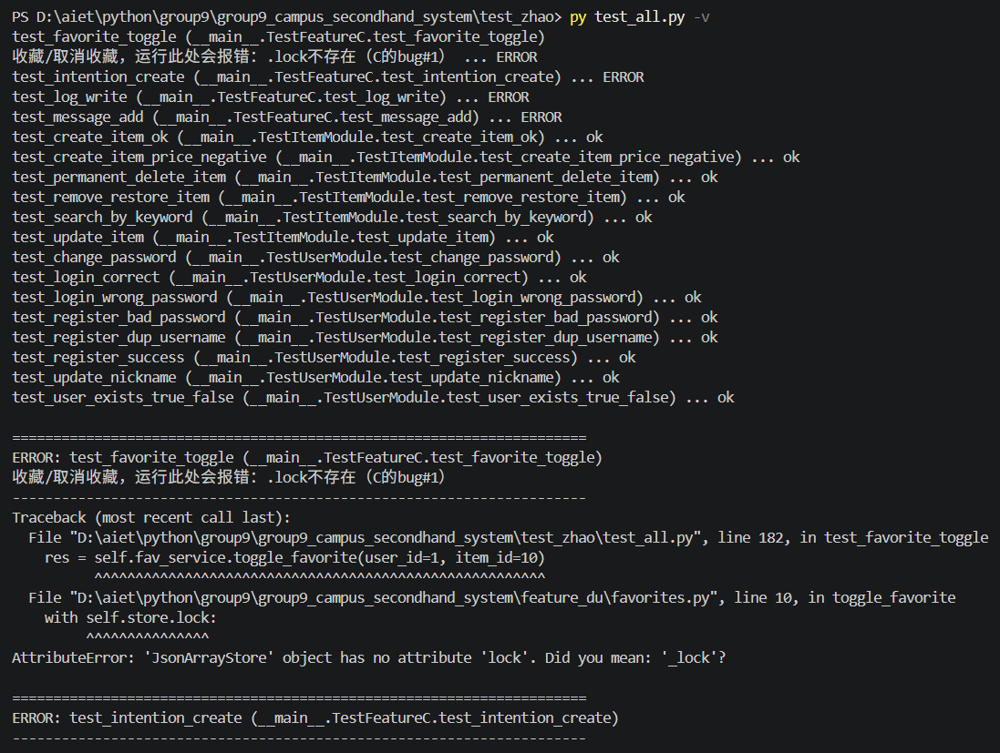
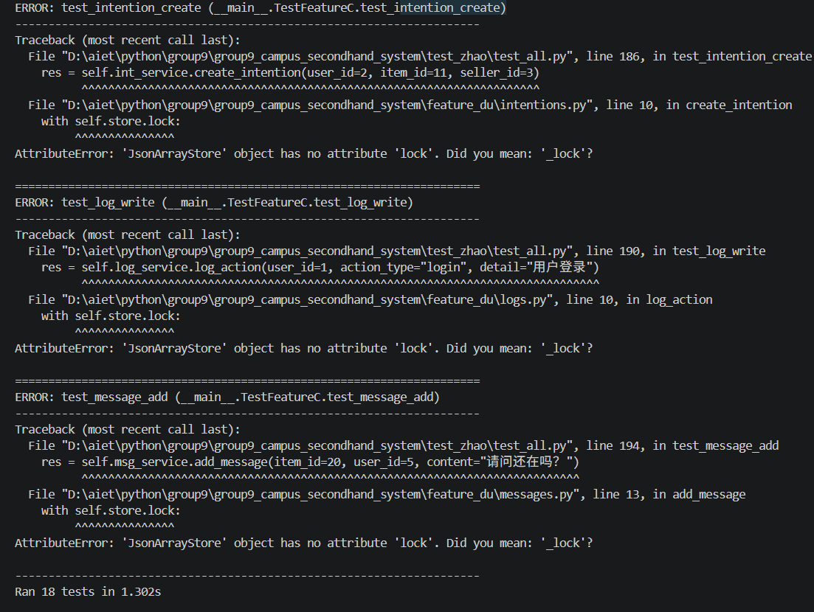
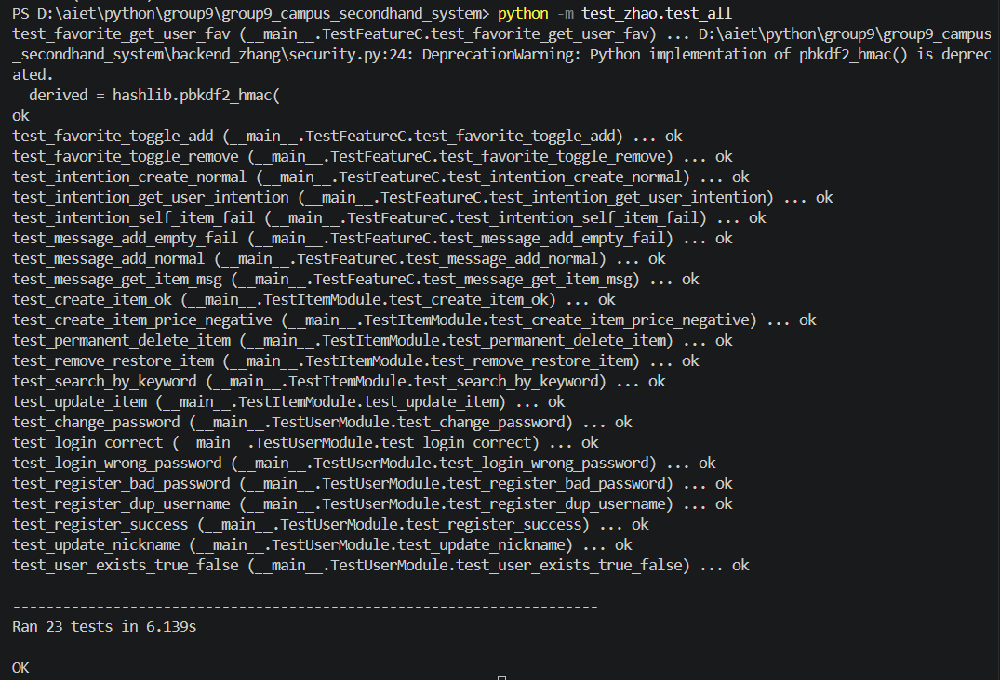

# Test Record Document  ZHAO Xiaojun
> Test script: test_zhao/test_all.py
> Test framework: Python unittest
> Execution entry point: `python -m test_zhao.test_all`
> Test environment: Windows, Python
> Test strategy:
> 1. User and item modules: Unit-test the business interfaces; use separate temporary JSON files throughout to isolate production business data and prevent contamination of live data.
> 2. Additional feature modules: Favorites, purchase intentions, and item messages. Multiple blocking code defects were discovered during testing and fixed in coordination.
> 3. The GUI (Tkinter) view layer is outside the scope of automated unit testing. GUI interaction, interface display, and workflow navigation are tested separately through manual GUI testing.

## 1. Test Case List (During Iteration)
### User Module Test Cases
1. Successful user registration
2. Registering with a duplicate username
3. Registration failure when the password does not meet requirements
4. Successful login with the correct username and password
5. Login with an incorrect password
6. Change the user's nickname
7. Change the user's password
8. Check whether a user exists

### Item Module Test Cases
1. Publish an item successfully
2. Publish an item with a negative price (reject invalid input)
3. Search for items by keyword
4. Unlist and relist an item
5. Permanently delete an item
6. Edit item information

### Additional Module Test Cases (Expanded During Iteration)
> Only the first 4 basic cases were completed in the second test round; boundary validation cases were added later, bringing the total to 9.
1. Toggle favorite status (add/remove)
2. Retrieve a user's favorites list
3. Submit a purchase intention
4. Retrieve a user's intention records
5. Prevent submitting an intention for one's own item (boundary case)
6. Add an item message successfully
7. Reject blank messages
8. Retrieve all messages for an item

## 2. Run Statistics (By Round)
First run
Issue: An error occurred when creating an item, indicating that the item category was invalid.
Root cause: The item category passed in by the test script was not in the backend's predefined whitelist. This was not a backend bug.
Resolution: Consulted the backend specifications and changed the item category in all test cases to a whitelisted value: `Electronics`.

Second run
> This run: Ran 18 tests
> Passed: 14  Failures (F): 0  Errors (E): 4
> Note: All 14 test cases for the user and item modules passed. At that time, the 4 basic test cases for the additional modules all triggered runtime exceptions due to blocking code defects.

Third run
Error: `AttributeError: 'JsonArrayStore' object has no attribute 'read'`
File: messages.py
Root cause: The message service called the nonexistent `.read()` method. The project's storage component uses `.load()` as its standard read method.
Resolution: Updated messages.py in coordination: `self.store.read()` → `self.store.load()`. Business logic was unchanged.

Fourth run
Error: `AttributeError: 'JsonArrayStore' object has no attribute 'write'`
File: messages.py
Root cause: After fixing the read method, the save logic still called the nonexistent `.write()` method. The project's standard write method is `.save(data)`.
Resolution: Changed `self.store.write(messages)` → `self.store.save(messages)`, aligning the read/write interface with the favorites and intentions modules.

Fifth run
Error: `ModuleNotFoundError: No module named 'json_array_store'`
Root cause: messages.py used a bare import, unlike the standard import style in favorites and intentions. JsonArrayStore is a component in the backend_zhang package, not a top-level module.
Resolution: Aligned the import statement with those in the other service files, using `from backend_zhang.json_store import JsonArrayStore` throughout to eliminate the import error.

Sixth run
All blocking issues were fixed, and the remaining boundary test cases for the feature modules were added, bringing the total number of test cases to 23.
This run also produced the following warning: `DeprecationWarning: Python implementation of pbkdf2_hmac() is deprecated.` This warning comes from backend_zhang.security and is a notice from an underlying library; it does not affect business functionality.
After this run, member A and member C made further modifications and adjustments to their corresponding code modules for consistency and robustness.

Final regression run
Re-executed the complete test suite after the code adjustments from member A and member C. All twenty-three test cases passed successfully. The deprecation warning from the security module still appears but remains harmless to business logic.

Full execution output:
Ran 23 tests in 6.139s

OK

## 3. Bug Report List
| Bug ID | Module | Reproduction Steps | Symptom | Severity | Current Status | Fix Description |
|---|---|---|---|---|---|---|
| B‑001 | feature_du all services | Call methods such as `toggle_favorite` / `create_intention` / `add_message` | Directly accesses `self.store.lock`, but the lock in JsonArrayStore is a private attribute `_lock`, causing an AttributeError and preventing the feature from running | High | Fixed | Removed direct lock access; use the `transaction()` method provided by JsonArrayStore for safe read-modify-write operations, following the storage component’s official convention |
| B‑002 | feature_du (messages.py, favorites.py, intentions.py) | Instantiate service objects of each type | Code uses the nonexistent class name `JsonStore`, but the actual class provided by backend_zhang is `JsonArrayStore`, triggering a NameError; import statements were not synchronized with class renaming | High | Fixed | Replaced all occurrences globally: `JsonStore` → `JsonArrayStore`, and updated all import statements |
| B‑003 | feature_du/messages.py | Call `add_message` or retrieve the message list | Calls the nonexistent storage method `read()`, causing `AttributeError: 'JsonArrayStore' object has no attribute 'read'` | High | Fixed | Standardized the read method to `.load()` to conform to the project storage interface |
| B‑004 | feature_du/messages.py | Save data after adding a message | Calls the nonexistent storage method `write()`, causing `AttributeError: 'JsonArrayStore' object has no attribute 'write'` | High | Fixed | Standardized the write method to `.save(data)`, forming the matching `.load()` / `.save()` pair |
| B‑005 | feature_du/messages.py | Run or import MessageService directly | The import statement `from json_array_store import JsonArrayStore` causes `ModuleNotFoundError` | High | Fixed | Standardized import: `from backend_zhang.json_store import JsonArrayStore` |

## 4. Final List of All Automated Test Cases (23 Total)
### TestUserModule: User Module (8 cases)
1. test_register_success: Register a user successfully
2. test_register_dup_username: Registration fails with a duplicate username
3. test_register_bad_password: Registration fails when the password does not meet requirements
4. test_login_correct: Login succeeds with the correct username and password
5. test_login_wrong_password: Login fails with an incorrect password
6. test_update_nickname: Change the user's nickname
7. test_change_password: Change the password and log in successfully with the new password
8. test_user_exists_true_false: Check whether a user exists (exists / does not exist)

### TestItemModule: Item Module (6 cases)
9. test_create_item_ok: Publish an item successfully
10. test_create_item_price_negative: Reject publishing an item with a negative price
11. test_search_by_keyword: Search for an item by keyword
12. test_remove_restore_item: Complete the full item unlisting and relisting flow
13. test_permanent_delete_item: Permanently delete an item
14. test_update_item: Edit basic item information

### TestFeatureC: Favorites, Intentions, and Messages (9 cases)
15. test_favorite_toggle_add: Add a favorite
16. test_favorite_toggle_remove: Add a favorite, then remove it
17. test_favorite_get_user_fav: Retrieve the specified user's favorites list
18. test_intention_create_normal: Submit a purchase intention successfully
19. test_intention_self_item_fail: Prevent submitting an intention for an item listed by the same user (boundary validation)
20. test_intention_get_user_intention: Retrieve all purchase intentions for a user
21. test_message_add_normal: Submit an item message successfully
22. test_message_add_empty_fail: Reject a blank message
23. test_message_get_item_msg: Retrieve all messages for a specified item

## 5. Test Conclusions
A total of 23 automated interface test cases were designed, covering positive business workflows, rejection of invalid input, entity state transitions, and boundary constraints.

The `backend_zhang` user and item service layers are stable in parameter validation, basic CRUD, item listing and delisting, deletion, search, and other business logic. They correctly reject invalid input such as negative prices and duplicate usernames, and all unit tests passed.

The `feature_du` additional modules initially had multiple blocking defects: an incorrect storage class name, mismatched read/write method names, improper lock access, and an incorrect import path. After coordinated code changes in the sixth test run, all blocking defects were resolved. Member A and Member C then carried out further refinement on their respective code modules. The final regression run verified that the whole system remained fully compatible; the complete test suite passed without failures. API behavior conforms to the specifications, and all defined business constraints are enforced correctly.

Code review also identified two non-blocking risks: missing input validation and a potential for duplicate intention IDs. These issues are deferred as follow-up optimization tasks; validation logic and a more reliable ID generation approach will be added in a future version.
